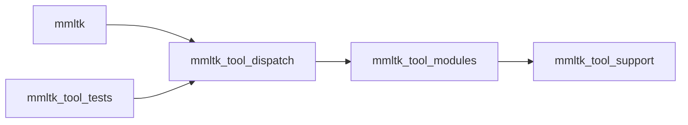

# Building and reusable state

[Wiki index](README.md) · [Quick start](../README.md#build) · [Commands](commands.md) · [Validation](validation.md)

## Host and container boundary

Use the native [./mmltk wrapper](../tools/mmltk.cpp) for builds and execution.
Linux and NVIDIA CUDA are required; the desktop additionally requires Wayland.
The invoking account needs Docker, Buildx for image builds, and NVIDIA container
GPU access. Ordinary build/runtime operations probe Docker and attempt a
noninteractive daemon start; read-only diagnostics require a running daemon.

Toolchains run in containers. Normal runtime reuses a repository-scoped container;
builds, tests, and image diagnostics own theirs. [Process snapshots](commands.md#process-snapshots)
inspect existing containers without creating one. GUI/runtime and Wayland
acceptance use privileged containers and host mounts; [log](logging.md) and
[I/O diagnostics](gpu-execution.md) use restricted read-only mounts.

Execution containers receive `SYS_NICE`, `IPC_LOCK`, unlimited memlock, and the
configured nice limit. CPU compiler arenas use page locking without CUDA
registration; failed placement or pinning fails preparation. [Fixed pinned arenas](compile-execution.md#fixed-pinned-arenas)
own the storage budgets.

## Native tools and checkout bootstrap

The generated root `./mmltk` is an optimized, stripped Linux ELF. Bootstrap a
checkout without it from the repository root:

```bash
./tools/bootstrap/bootstrap_mmltk.sh --launch "$PWD" --build-tools
```

After bootstrap, use `./mmltk --build-tools` to rebuild tools and
`./mmltk --tidy-tools` for analysis.

[bootstrap_mmltk.sh](../tools/bootstrap/bootstrap_mmltk.sh) prepares GCC/tools
images, builds in a container, publishes the executable/library closure, then
launches the requested operation. It needs no host compiler. `--build-tools`
reconfigures/builds/installs only the standalone graph; `--tidy-tools` formats
and validates its registered units without publication. Rebuild changed tools
before exercising them. Full `--build` also ensures current tools.

[tools/CMakeLists.txt](../tools/CMakeLists.txt) owns the independent graph;
[Dockerfile.tools](../docker/Dockerfile.tools) supplies its environment.
`MMLTK_TOOLS_IMAGE` defaults to `mmltk-tools:latest`.

Publication writes `build/.tools-generations/<generation>/` with `mmltk`,
`mmltk-tests`, `lib/`, and `.inputs.sha256`, atomically points `build/tools` at
it, then atomically replaces the root ELF. RPATH resolves adjacent container
libraries or the immutable host generation. Keep the closure: older generations
remain usable by running processes. Mutations share a lock; resolved native-user
ownership applies after cold-bootstrap handoff. [RuntimeClosure.cmake](../tools/cmake/RuntimeClosure.cmake)
owns installed libraries; [fixture isolation](#composition-and-fixture-isolation)
keeps production and test executables separate.

Freshness hashes tool input names/contents, including untracked edits, vendored
JSON, GCC/tools Dockerfiles, and the NVIDIA manifest. `.inputs.sha256` lets
`--build` reuse current tools; `--build-tools` explicitly reruns preparation.
Freshness inventory does not define CMake membership.

## Standalone tools module graph

[tools/CMakeLists.txt](../tools/CMakeLists.txt) owns `.cache/cmake/tools`: GCC
16.2, C++26 reflection/module mode, exactly CMake 4.4.3, module scanning, and mold.
Release adds `-Os`, LTO, function/data sections, and dead-section removal;
bootstrap strips both executables. This graph builds its own compiler launcher
without using it; the product consumes published `module-safe-compiler-launcher`
through [MmltkToolchain.cmake](../cmake/MmltkToolchain.cmake).

Only `CMakeLists.txt` and `mmltk.cpp` live at `tools/` root:

| Directory | Owner |
| --- | --- |
| `driver/` | Reflected command vocabulary, dispatch, container commands |
| `support/` | Text, process/JSON, digest, Linux, locale, library, time utilities |
| `toolchain/`, `bootstrap/`, `cmake/` | Build, analysis, packaging, publication, registration |
| `cleanup/` | Deduplication, declaration formatting, include audit, lexical patterns |
| `logging/` | Query interface, private partition, runtime |
| `diagnostics/` | Capability, process, native-artifact, data inspection; product helpers have separate targets |
| `maintenance/`, `profiling/` | Maintenance and build/command traces |
| `oracle/` | Upstream producer and pinned Python requirements |
| `wayland/` | Supervisor, Weston seat, compositor configuration |
| `tests/` | Fixture composition, runner, support, inputs |

### Composition and fixture isolation

CMake registers sources, module providers/partitions, generated adapters, and
links explicitly. Consumer → provider:



[tool_command.cpp](../tools/driver/tool_command.cpp) owns the reflected enum,
spellings/logical program names, parsing/storage, and exhaustive visitation;
it imports support only. [tool_dispatch.cpp](../tools/driver/tool_dispatch.cpp)
binds production implementations. Lower modules consume actual providers,
without dispatcher imports or umbrella re-exports.

The fixture runner's [private dispatch](../tools/tests/tool_dispatch.cpp)
selects fixtures and delegates production commands. Production dispatch launches
external `mmltk-tests` for fixtures. Fixture objects share the module archive,
but only the runner extracts them; the driver imports no fixture composition
and uses no whole-archive link.

Log-query `:internal`/`:tests` belong to one module family. Its primary interface
imports neither; runtime and fixtures consume that interface and private
implementation, testing one compiled production implementation. Lower modules
and fixtures never import dispatchers.

### Standard-library provider and textual boundaries

All authored tools C++ units import `std`, including isolated diagnostics,
oracle, and Weston modules. [StdModules.cmake](../tools/cmake/StdModules.cmake)
sets the pinned-CMake feature gate before CXX discovery in both entry projects.
[Toolchain.cmake](../tools/cmake/Toolchain.cmake) requires C++26 standard-module
availability and sets `CXX_MODULE_STD` per tools target. Product uses it only
for its two diagnostic targets; no global product/vendor policy is imposed.

CMake reads GCC `libstdc++.modules.json`, builds `bits/std.cc`, and creates
compatible BMI variants for consumer C++26/reflection settings. It owns providers,
compilation, and dependency order. BMIs remain build artifacts, excluded from
source and installed runtime closure. `CXXDependInfo.json`, `CXXModules.json`,
and `.ddi` files beneath `CMakeFiles/<target>.dir/` record dependencies;
`compile_commands.json` records settings. CMake registration owns membership.
Standard-module setup participates in product/isolated-image fingerprints.

Textual includes supply C/POSIX/vendor declarations, macros, and canonical
ordinary product headers. Weston and its generated C adapter include `<cmath>`
before `libweston.h`, whose `extern "C"` path reaches `math.h`; this avoids linkage
conflicts with imported standard declarations. Product headers remain
[self-contained ordinary headers](#target-declarations-and-precompiled-headers).

### Isolated process and plugin owners

The host wrapper and `/opt/mmltk-tools/mmltk` differ from product
`/opt/mmltk/bin/mmltk`; driver startup needs no GPU initialization or Python.

| Owner | Boundary |
| --- | --- |
| Compiled-sample / COCONut mask helpers | Product-dependent [entrypoint targets](../src/entrypoints/tools/CMakeLists.txt); [diagnostic graph](#benchmark-diagnostic-builds) |
| Upstream RF-DETR producer | Native executable embedding donor CPython; [oracle image](#upstream-reference-image) |
| Weston seat | Named module with generated C ABI adapter; [validation image](headless-wayland.md#validation-input-seat) |

[Toolchain.cmake](../tools/cmake/Toolchain.cmake) generates adapters from registered
modules/entrypoints. Isolated libraries do not enter the driver. Use [public
commands](commands.md#native-tool-entrypoints) for container admission, mounts,
process ownership, and diagnostics.

## Release builds

```bash
./mmltk --build
```

`--build` configures Release CMake/Ninja, installs native deliverables, publishes
Iced, builds owned Firefox, and assembles the runtime image. Toolchain/Release
and independently fingerprinted runtime-base preparation can overlap; Ninja can
overlap native compilation, browser bundling, and Firefox's coarse edge.
Firefox internally uses Mach/RecursiveMake/Cargo.

The canonical bundle is `build/browser-app/dist`, mounted read-only by `--gui`.
Missing/incompatible bundles fail launch; rebuild after native contract changes.
[Frontend CMake](../src/frontend/iced/CMakeLists.txt) tracks Iced, iced_aw,
iced_plot, iced-fluent-theme sources/manifests, and plot WGSL. Host Rust tests
compile with `--no-run`, independently of optimized `trunk build --release` Wasm;
[validation](validation.md#native-and-browser-suites) owns actual execution.

The [bundle publisher](../src/frontend/iced/browser_dist_publish.cpp) skips
HTML/JavaScript comments when resolving quoted hashed Wasm URLs, rejects
ambiguous/escaping references, and requires the selected asset. Browser
JavaScript fixtures exercise admission and optional window-trace hooks.

Keep the native CLI beside `mmltk-browser-host`: desktop passes that sibling to
local training. The bundle alone cannot provide it. `--build-gui` formats/checks
Iced and rebuilds only the GUI graph's bundle; it can precede `--gui` in one
invocation. Native/Firefox changes require full `--build`.

Firefox source is `third_party/firefox`; no replacement checkout is fetched.
Its toolchain/sysroot preparation is separately cached. Test it only through
first-party suites and packaged acceptance.
[firefox_runtime_files.txt](../src/entrypoints/desktop/firefox_runtime_files.txt)
owns required files and derived CMake byproducts. [build_firefox_runtime.sh](../src/entrypoints/desktop/build_firefox_runtime.sh)
passes `--runtime-manifest` to Firefox's [mmltk-stage-runtime](../third_party/firefox/python/mozbuild/mozbuild/mach_commands.py),
which checks current/candidate completeness and includes manifest bytes in the
atomic-staging fingerprint. The wrapper's outer fingerprint includes it too.

## Toolchain and image inputs

First-party ordinary C++ uses GCC 16.2 and C++26 reflection. CUDA uses NVCC
13.4, CUDA C++23, and GCC 16.2 as the host compiler with the explicit
unsupported-host override. GCC 14 is confined to the GCC 16.2 bootstrap.
Explicit ONNX, simdjson, and cppcheck source builds use GCC 16.2 while retaining
their configured language policies. Vendored dependencies keep their own
policies; Firefox retains its cached Clang toolchain and bootstrap sysroot.
The frontend Cargo workspace includes the owned `third_party/iced_plot` and
`third_party/iced_aw` crates. Plot declares its native test/renderer dependencies
in its own manifest, including package-selected tests and doctests.

[CMakeLists.txt](../CMakeLists.txt) requires exactly CMake 4.4.3.
[MmltkToolchain.cmake](../cmake/MmltkToolchain.cmake) enforces product compiler
paths and versions; [CMakePresets.json](../CMakePresets.json) defines the product
graphs. The [standalone tools graph](#native-tools-and-checkout-bootstrap)
owns its corresponding toolchain settings independently.
First-party native links and owned Firefox links use mold; the Iced browser
artifact targets WebAssembly.
Product host and CUDA host code use function/data sections for the native
garbage-collecting link. Product Release C/C++ uses the configured IPO policy.
Its host compilation selects `-march=native` and `-mtune=native`; the x86-64 policy
also enables SSSE3, SSE4.2, AVX2, and FMA. [Image and mask conversion](datasets.md#resize-geometry)
uses these existing native facilities with bounded tails.
The [native link diagnostics](validation.md#native-symbol-and-link-diagnostics)
inspect existing objects and repeat one generated link without replacing the
Release artifact.
Core compilation uses ccache; Firefox retains its canonical objdir, Cargo
dependency information, and sccache.
The container supplies Rust, `wasm32-unknown-unknown`, Trunk, wasm-bindgen,
wasm-opt, and the other configured build tools.

Development and runtime bases are independent Ubuntu 24.04 stages.
[docker/nvidia-payload.json](../docker/nvidia-payload.json) is authoritative for
the digest-pinned NGC donor, selected CUDA/Torch/TensorRT/Python libraries,
normalized paths, dependencies, and notices. Its selected closure includes
NCCL and Torch's CPU MKL libraries; ONNX Runtime is packaged separately.
Image and staged-output fingerprints govern reuse of the final runtime.

ONNX Runtime 1.27.1 is built by
[Dockerfile.onnxruntime](../docker/Dockerfile.onnxruntime). Its
[CUDA graph capture patch](../docker/patches/onnxruntime-1.27.1-cuda-graph-capture.patch)
and GCC compatibility patch are inputs to the wrapper's dependency
fingerprint. The capture patch owns both thread-local capture and capture-end
RAII cleanup; [GPU execution](gpu-execution.md#onnx-capture-and-verification-storage)
explains the independent-worker behavior. The dependency retains its own
C++/CUDA language policies.

Inspect public header selection with:

```bash
./mmltk --diagnose-nvidia-payload donor cudalibxt.h cufftXt.h
./mmltk --diagnose-nvidia-payload development cudalibxt.h cufftXt.h
```

`donor` uses BuildKit and writes its report under
`build/diagnostics/nvidia-payload`; `development` inspects an existing build
image without rebuilding it. Supply public filenames, not directory paths.
Reports include locations, package ownership, direct includes, and selection.

### Numerical compilation policy

First-party Release retains normal optimization and FMA, with configured IPO
and explicit per-source exclusions. Compile commands describe first-party
compilation, not TorchScript's later NVRTC options or every packaged library.

Fast math combines denormal/division/square-root changes; FMA is also normally
enabled and alone does not establish fast math. See [NVCC](https://docs.nvidia.com/cuda/cuda-compiler-driver-nvcc/index.html#use-fast-math-use-fast-math),
[NVRTC](https://docs.nvidia.com/cuda/nvrtc/index.html#supported-compile-options),
and [floating-point behavior](https://docs.nvidia.com/cuda/floating-point/index.html).
[Native selective compilation](rfdetr-training.md#native-selective-compilation)
owns function-local precision policy.

### Upstream reference image

[Dockerfile.rfdetr-oracle](../docker/Dockerfile.rfdetr-oracle) starts from the
complete pinned NGC donor to run actual upstream Python with compatible Torch/CUDA.
It is validation-only, separate from independently based product images.

[Pinned wheels](../tools/oracle/rfdetr_oracle_requirements.txt) install with
`--no-deps` into private `/opt/rfdetr-oracle/python`, preserving donor packages.
The separate native `mmltk-rfdetr-upstream-oracle` [producer](../tools/oracle/generate_rfdetr_upstream_oracle.cpp)
embeds CPython, imports upstream libraries, and verifies payload/dependency closure.
Its tools graph disables the driver. `./mmltk --diagnose-rfdetr-upstream --build-only`
prepares/checks this image without weights, references, or native comparisons.

The image fingerprint binds upstream revision, donor/payload manifest, Dockerfile,
requirements, selected native sources/rules, and actual tools-image identity.
Runs additionally bind upstream tree, selected preparation mode and execution
policy. Sources/Git metadata mount read-only; evidence and the shared model asset
cache mount writable for publication/acquisition, with temporary storage inside
the container. Completed reference payloads are made read-only. The selected
[encoder mode](validation.md#encoder-pretraining-evidence) uses the same isolated
producer and dependency closure, with a distinct evidence identity.
[Upstream validation](validation.md#independent-upstream-diagnostic)
owns explicit opt-in, storage/retention, admission, retries, and verdicts.

### Native Parquet dependency

[Dockerfile.dependencies](../docker/Dockerfile.dependencies) verifies Apache
Arrow/Parquet **25.0.1** by SHA-512 and builds static PIC libraries with GCC
16.2/upstream C++20. Bundled pins follow that release. Enabled: Parquet/IPC,
Snappy, Zstandard, zlib, xsimd, Thrift, RapidJSON, and transitive Boost. Disabled:
cloud filesystems, Dataset/Compute/Flight, Python, utilities, examples, tests,
and benchmarks. No Arrow runtime DSO or replacement allocator is installed.

[The data target](../src/backend/data/CMakeLists.txt) requires exact `/opt/arrow`
and privately links `Arrow::arrow_static`/`Parquet::parquet_static`. [Native
COCONut import](benchmark-datasets.md#native-import-and-provenance) owns formats;
libcurl, libarchive, and rapidgzip retain acquisition/extraction.
Arrow and six selected dependency notice directories, plus Boost notices,
install under `share/mmltk/licenses/arrow`; [runtime inventory](../tools/toolchain/runtime_package.cpp)
includes `/opt/mmltk/share/mmltk/licenses/arrow`. See [NOTICE](../NOTICE).

### Native caption and video assets

The [raster target](../src/backend/imaging/raster/CMakeLists.txt) embeds the
existing `src/frontend/iced/assets/SourceSansPro-Regular.otf` into generated
`caption_font_data.h` in that component's CMake build directory. The font is a
configure dependency; native saved-caption rendering has no runtime font-path
lookup. Its OFL installs under `share/licenses/mmltk/caption-font`.
The shared `stb` target includes unmodified stb_truetype 1.26; its header and
MIT license install under `share/licenses/mmltk/stb-truetype`. See the
[vendored addition note](../third_party/stb/README.mmltk.md). Application caption
policy remains in the raster owner, while Iced keeps interactive layout.

The [video target](../src/backend/media/video/CMakeLists.txt) consumes
`libavformat`, `libavcodec`, `libavutil` and `libswscale` through pkg-config.
Development installs their headers; both the development and independent
runtime base install FFmpeg and `libx264-164`. Native prediction Full-video
output selects `h264_nvenc` when admitted, with `libx264` as the pre-write
software fallback. A built runtime therefore carries the software encoder as
well as the GPU-dependent path; [workflow behavior](rfdetr-workflows.md#prediction-samples-and-full-video)
owns selection and settlement.

## Target declarations and precompiled headers

Component CMake registers sources, ordinary headers, retained modules, and
visibility through [MmltkSourceRegistration.cmake](../cmake/MmltkSourceRegistration.cmake).
Declaration-only projections consume owner usage requirements without linking
implementation. Header-isolation dependencies compile generated one-include
units with those requirements, no unity/PCH/forced includes; selected boundaries
also check both include orders.

The [Torch component](../src/backend/ml/torch/CMakeLists.txt) separately registers
`mmltk_backend_ml_torch_archive_cbor` for the shared
[archive/CBOR boundary](architecture.md#reflected-value-and-persistence-boundaries).
It publishes its own Torch and serialization declaration requirements and header
isolation; ordinary Torch consumers do not inherit serialization through a broad
umbrella. Domain test-support targets likewise own their registered fixture
headers and usage requirements; [fixture ownership](validation.md#shared-fixtures-and-evidence)
locates the encoder-training support shared by training, inference, CLI and
Wayland acceptance.

Normal product PCH groups:

| Owner | Explicit shared headers |
| --- | --- |
| `mmltk_backend_data`, `mmltk_controller_direct_services` | `src/pch_std.h`, `src/pch_linux.h`, `src/pch_json.h` |
| `mmltk_backend_models_rfdetr_core`, `mmltk_backend_models_rfdetr_training` | `src/pch_std.h`, `src/pch_linux.h`, `src/pch_torch.h` |
| `mmltk_backend_ml_cuda` | `src/pch_std.h`, `src/pch_torch.h` |

Consuming implementations include group headers instead of their individual
members. Standard/Linux groups contain headers observed in at least three
first-party files; JSON contains nlohmann, Torch only C10 CUDA stream/guard
headers. C++26 headers are language-gated; reflection also requires its feature
macro. Group membership is reviewed, never inferred from a `pch_` name or
expanded/pruned by the audit.

Each owner compiles its own PCH with its own environment. Declaration headers,
C/CUDA, retained module providers/implementations/importers, header-isolation
units, standalone/no-PCH code, and sources with distinct settings retain direct
includes. Includes outside a consumed group stay direct. The [tools standard
module policy](#standard-library-provider-and-textual-boundaries) is separate.

[MmltkComponent.cmake](../cmake/MmltkComponent.cmake) derives
`CMakeFiles/<target>.dir/mmltk-pch-policy.txt`; generated `cmake_pch.hxx`/`.gch`
remain beside it. [Toolchain invariants](../tools/toolchain/check_toolchain_invariants.cpp)
verify compile-database creation/use equality, exclusions, and fatal invalid-PCH
diagnostics. [Include auditing](validation.md#pch-include-audit) requires all
source contexts and exact forced includes to agree, and runs those invariants
before fixes. Contradictory evidence blocks rewriting. Analysis retains
registration/isolation, selecting [GCC objects or clang-tidy](validation.md#formatting-and-static-analysis)
by reflection support. These checks establish build policy, not PCH speedup.

## Cache and output locations

These are the default repository-local locations:

| Path | Contents |
| --- | --- |
| `mmltk`, `build/tools`, `build/.tools-generations` | Root native driver and atomically published [immutable tools closures](#native-tools-and-checkout-bootstrap) |
| `.cache/cmake/tools` | Independent tools graph and compilation database |
| `.cache/cmake/release` | Shared Release build/test graph |
| `.cache/cmake/gui`, `.cache/cmake/dev`, `.cache/cmake/analysis` | Other wrapper-selected graphs |
| `.cache/cmake/benchmark-image-release` | CMake graph and native helpers for [benchmark image diagnostics](#benchmark-diagnostic-builds) |
| `.cache/cargo/home`, `.cache/cargo/target/browser-app` | Cargo downloads and browser artifacts |
| `.cache/ccache` | Core compiler results |
| `.cache/firefox/obj-minimal-opt`, `mozbuild`, `sccache` | Firefox objects, toolchain/sysroot state, compiler cache |
| `.cache/browser-app` | Shared bundle fingerprints and publication state |
| `.cache/buildkit` | Exported image-build caches |
| `.cache/image-fingerprints`, `.cache/locks` | Verified identities and mutation locks |
| `.cache/tests/rfdetr` | RF-DETR test assets and derived artifacts |
| `.cache/mmltk/weights` | Shared canonical detector and original encoder assets; see [model asset cache](#model-asset-cache) |
| `.cache/benchmark-dataset/v1` | Persistent benchmark source archives, JPEGs, indexes, and completion metadata; see [cache ownership](benchmark-datasets.md#persistent-cache-and-publication) |
| `output/` | Repository-root product artifacts; automatic workflow roots and explicit destinations follow [workflow output policy](rfdetr-workflows.md#run-output-directories) |
| `build/release`, `build/browser-app` | Staged package and canonical browser bundle |
| `build/validation`, `build/logs` | Acceptance evidence and [build/test/tidy transcripts](logging.md#wrapper-build-test-and-tidy-transcripts) |
| `build/diagnostics` | Wrapper-owned capability, standalone GPU, and native-link diagnostic artifacts |

`MMLTK_CACHE_ROOT` may select a build-cache subtree of `.cache`; `MMLTK_RELEASE_STAGE_ROOT`
must remain below `build`. The wrapper rejects overlapping checkout/cache-root
mutations. Retain caches for incremental builds.
The root artifact ignore rule is `/output/`. Build products, dependency caches,
test scratch, and diagnostics retain their independent locations; explicit
user destinations are not redirected into `output/`.

`release` configures package and test targets; native tests are excluded from
the default build. `gui` selects browser work, while `dev` and `analysis`
provide non-package development graphs. A `tsan` configure preset exists, but
`./mmltk --test tsan` is currently rejected. Use the supported wrapper
operations in [validation](validation.md).

The data-owned `mmltk_backend_data_profile_runner` is `EXCLUDE_FROM_ALL`.
`--test data-profile` explicitly builds it (Release by default); ordinary builds
and `all` omit it. It reuses production owners/test fixtures. `profile_support.{h,cpp}`
own options, admission, geometry ordering, and trace selection; `profile_pipeline.cpp`
and `profile_compaction.cpp` own those modes. CPU modes need no CUDA context;
Loader does. [Profiles](validation.md#data-compilation-and-resampling-profiles)
own scratch, retained inputs, and explicit complete Coconut runs.

### Model asset cache

[ArtifactStore](../src/controller/services/artifact_store.cpp) defaults to the
repository root's `.cache/mmltk/weights`, shared by GUI, CLI and upstream evidence
preparation. This product asset location is independent of a wrapper build-cache
override. Canonical detector files retain their catalog filename and MD5 checks.
Original encoder assets live under
`encoders/<source-repository-with-slashes-replaced-by-dashes>-<source-revision>/model.safetensors`
and require both the canonical SHA-256 and exact byte length. The
[asset declaration](../src/backend/models/rfdetr/contract/encoder_pretraining.h)
owns URLs, immutable pins, source geometry and adaptation revision.

Both asset types use the same cancellable acquisition, progress, staging,
integrity and atomic publication path. Cache reuse verifies integrity; a corrupt
entry is removed before replacement. Failed or cancelled staging never becomes
the canonical asset. Encoder selection is typed by backbone and cannot substitute
for detector-weight selection. Multiple presets sharing a backbone reuse one
original source file.

The [CLI launch service](../src/controller/services/training/train_command.cpp)
validates scratch admission before acquisition, verifies any supplied resolved
path, and passes an absolute launch path to workers. Workers do not download;
the backend importer owns tensor admission/adaptation independently of controller
services. Saved weights/sessions remain [self-contained](model-merging.md#encoder-provenance).

[NOTICE](../NOTICE) retains encoder source attribution alongside RF-DETR,
RF-DETR+ and timm implementation notices; [LICENSE](../LICENSE) and NOTICE are
packaged by the root build. Source encoder licensing does not replace the
selected preset's implementation notices. The
[validation reference](validation.md#encoder-pretraining-evidence) owns generated
reference retention, separate from these reusable original assets.

### Benchmark diagnostic builds

`./mmltk --diagnose-benchmark-image` first asks its parser which native helpers
the selected arguments need. `--compiled` selects
`mmltk_diagnose_compiled_sample`; `--parquet` or `--panoptic` selects
`mmltk_diagnose_coconut_mask`. Their
[entrypoint CMake owner](../src/entrypoints/tools/CMakeLists.txt) registers both
named module implementations behind generated process adapters as
`EXCLUDE_FROM_ALL` executables, with explicit links and runtime paths.
The compiled helper depends on the canonical Dataset layout/admission
owner; the mask helper links Arrow, Parquet, JSON, and stb.

The wrapper reuses the existing development image and configures
`.cache/cmake/benchmark-image-release` with browser-host and Firefox runtime
builds disabled. It builds only the requested targets, under the cache mutation
lock and a 120-second deadline per target build. Generated
`benchmark-image-diagnostics.env` in that graph supplies their exact executable
paths to the read-only inspection container. Preparation output goes to stderr;
the final diagnostic keeps JSONL on stdout. Help and index/image/archive queries
use the published native tool without configuring product targets or requiring
a product package or Firefox fingerprint. See
[command inputs and outputs](commands.md#benchmark-image-geometry) for inspection
limits and evidence paths.

## Generated bindings and dependency maintenance

```bash
./mmltk --generate-application-bindings
./mmltk --generate-protocol
./mmltk --update-gui-lock
./mmltk --update-firefox-lock
```

Both generation commands select `mmltk_protocol_v17_generation` and produce
the bindings, package marker, graphics ABI, and both cross-language fixtures.
`--generate-application-bindings` uses the dedicated
`.cache/cmake/application-bindings-release` graph with browser-host and
Firefox runtime builds disabled. `--generate-protocol` uses the shared
`.cache/cmake/release` graph.

The [generator and wire reference](application-wire.md) owns canonical schema
inputs, projection/validation rules, native/Rust consumption and compatibility.

Under the selected graph's `generated/frontend/iced/`, generation owns:

| Artifact | Purpose |
| --- | --- |
| `application_bindings.rs` | Typed native domain projection, codecs, schema fingerprint, interaction limits, and reflected metric scalar selectors |
| `browser_protocol.marker` | Application package marker for the [current typed boundary](application-wire.md), `MMLTK_HOST_API_PROTOCOL_17` |
| `protocol_v17_client_records.hex` | Rust-to-native application fixture |
| `protocol_v17_server_records.cbor` | Native-to-Rust application fixture |
| `workspace_graphics_abi.rs` | Data-only native graphics ABI projection for Firefox; current ABI version 14 |

Generation alone neither repackages the host/bundle nor runs tests; the
[typed boundary](application-wire.md#connection-compatibility-and-failure-behavior) requires matching
packaged artifacts.

The graphics artifact derives records, field types, enum wire values, and
field-offset/size/alignment assertions from the native workspace import and
frame-signal declarations in [presentation/abi](../src/controller/presentation/abi).
Firefox includes it through `MMLTK_WORKSPACE_GRAPHICS_ABI`. CMake makes its
generation a direct Firefox build dependency and owns regeneration from the
native declarations and generator inputs.

The wrapper's `.cache/firefox/build-input.sha256` uses the version-3 outer
source key. It includes the dependency toolchain image identity,
`firefox_runtime_build.cmake`, `build_firefox_runtime.sh`, the runtime manifest,
the committed `third_party/firefox` tree, its tracked working-tree diff, and its
nonignored untracked files. Native declarations, the application generator, and
its CMake rules are handled by the generation graph rather than duplicated in
that outer source key.

`build_firefox_runtime.sh` combines that key with the runtime-manifest hash and
the emitted graphics ABI's content hash in
`.cache/firefox/obj-minimal-opt/.mmltk-build-input.sha256`. It skips Mach build
and staging only when this guard matches and every manifest entry exists.
Changed emitted ABI bytes therefore invalidate the guard even when Firefox's
source is unchanged; an unrelated generator edit producing identical ABI bytes
does not itself require Firefox compilation. Missing outputs or changed Firefox,
toolchain, build-script, manifest, or ABI inputs can still require work. These
guards retain the existing Firefox objdir, Clang/bootstrap sysroot, Cargo, and
sccache state.

Generated Rust stays in build output: change canonical native declarations
or generators, then regenerate. `--update-gui-lock` performs the containerized
Cargo fetch used to refresh the native browser-test dependency lock; ordinary
builds use the locked dependency set.
`--update-firefox-lock` runs offline Cargo metadata against Firefox's vendored
sources and `.cargo/config.toml.in`; it updates that dependency lock without
replacing the source checkout or running Firefox tests.

The private [Wayland validation image](headless-wayland.md) is separately
fingerprinted from the packaged runtime and build images. It adds Weston and
a validation-only input-seat module without replacing the application or
Firefox. Its builder and runtime use the same pinned Weston package version.

## Isolated build timing

[build_time_trace.cpp](../tools/profiling/build_time_trace.cpp) invokes `./mmltk --build`
with isolated cache, image, builder, and staging identities:

```bash
./mmltk --tool build-time-trace -- --cache-key comparison --label cold
./mmltk --tool build-time-trace -- --cache-key comparison --warm-rebuild --label warm
./mmltk --tool build-time-trace -- --cache-key comparison --no-op --label noop
```

Omit `--cache-key` for a fresh cold cache. Warm/no-op modes require a completed
prior run with that key and are mutually exclusive. `--warm-rebuild` removes
only that key's CMake tree, Firefox objdir, and staged products, retaining its
compiler/Cargo/mozbuild/browser/BuildKit caches. The normal caches are unchanged.

Reports live under `build/time-trace/<key>/runs`; isolated reusable state lives
under `.cache/build-time-trace/<key>`. Reports include phase/stage events,
configure reuse, job allocation, build overlap, compiler-cache statistics,
browser/Rust work, package-cache outcomes, and runtime layer sizes. Each key
has its own overlap lock.
